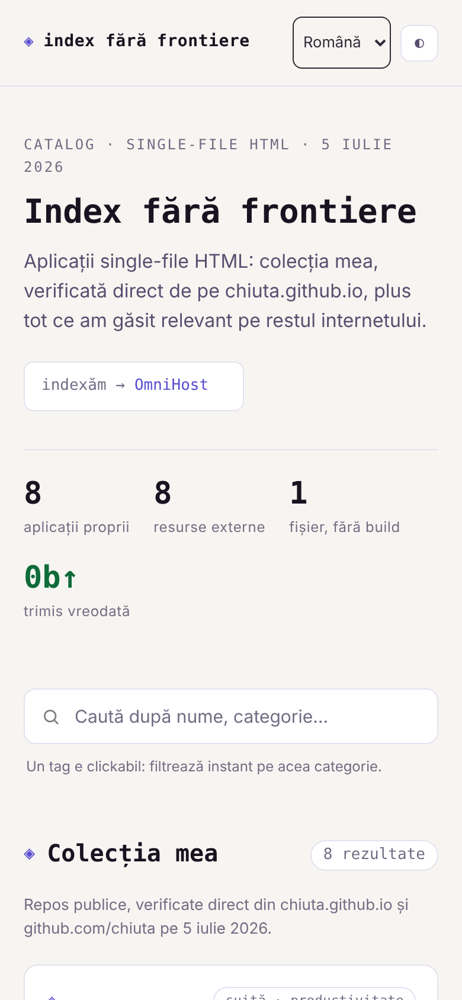
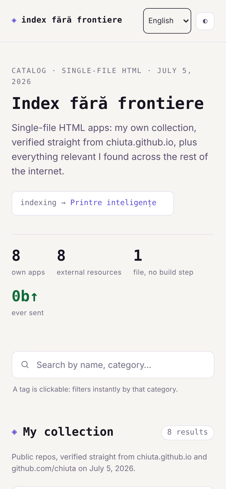
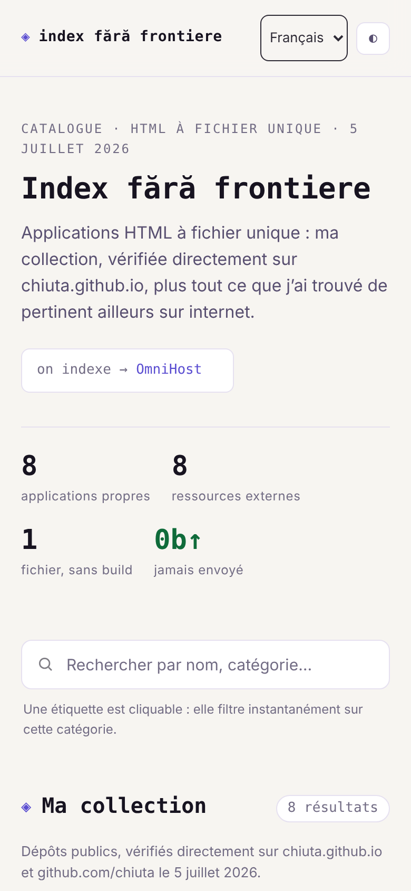
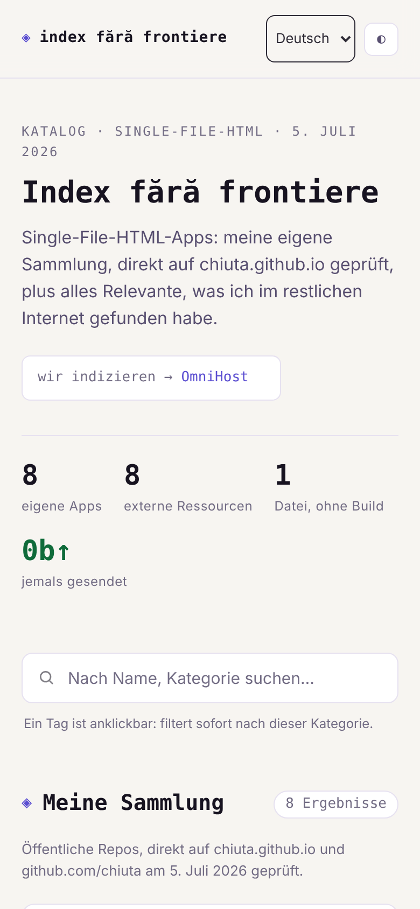
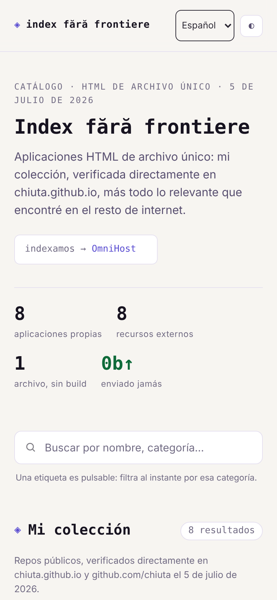
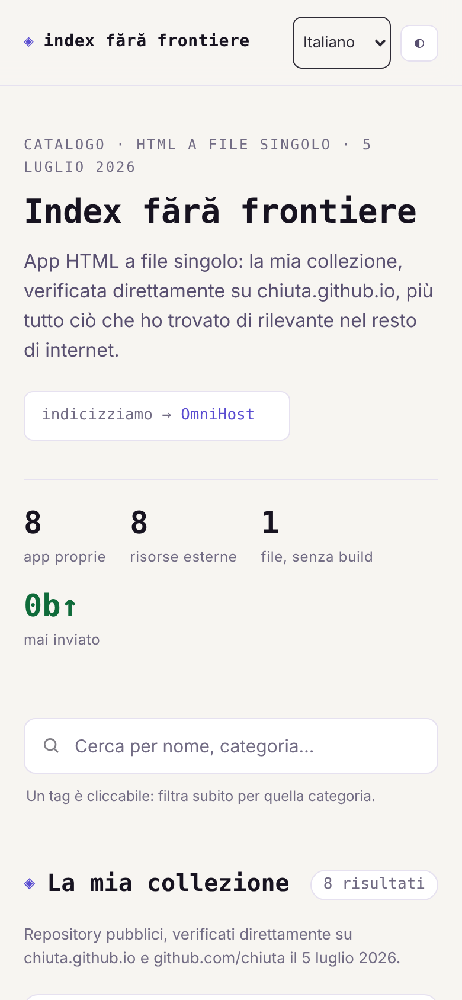
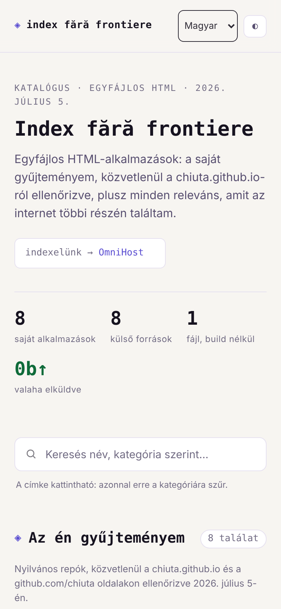
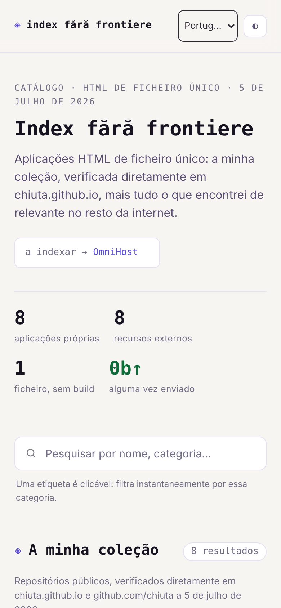

# Index fără frontiere

[English](README.md) · [Română](README.ro.md) · [Français](README.fr.md) · [Italiano](README.it.md) · **Español** · [Português](README.pt.md) · [Deutsch](README.de.md) · [Magyar](README.hu.md)

Catálogo de aplicaciones HTML de archivo único: la colección de chiuta.github.io y recursos externos relevantes.

**[Abrir la aplicación →](https://index-fara-frontiere.chiuta.ro/)**

_Versión: 1.2.3 · Última actualización: 2026-11-19_

| 1 | 2 | 3 |
|---|---|---|
|  |  |  |

## Capturas de pantalla

       

## Funciones

- Ocho proyectos de la colección del autor y ocho recursos externos, claramente marcados.
- Búsqueda en vivo, etiquetas pulsables, selector de idioma (8 idiomas), tema oscuro/claro, entrada autorreferencial.
- Totalmente sin conexión: sin peticiones de red ni telemetría (CSP `connect-src none`).

## Uso

Abre la página en línea, o descarga `index.html` y ábrelo en un navegador reciente. Sin instalación ni build.

## Límites

- Instantánea estática comprobada el 5 de julio de 2026; no se actualiza automáticamente.
- Las entradas están en los arrays `OWN` y `EXTERNAL` al inicio del script.
- Interfaz en 8 idiomas (RO, EN, FR, DE, ES, IT, HU, PT), elegible en el selector de la aplicación; traducciones asistidas por máquina, no revisadas por hablantes nativos.

## Privacidad

Sin seguimiento, sin peticiones de red (CSP `connect-src none`), sin cuentas. Los datos permanecen en este navegador (localStorage) y se pueden borrar en cualquier momento.

## Licencia

MIT — véase [LICENSE](LICENSE).
