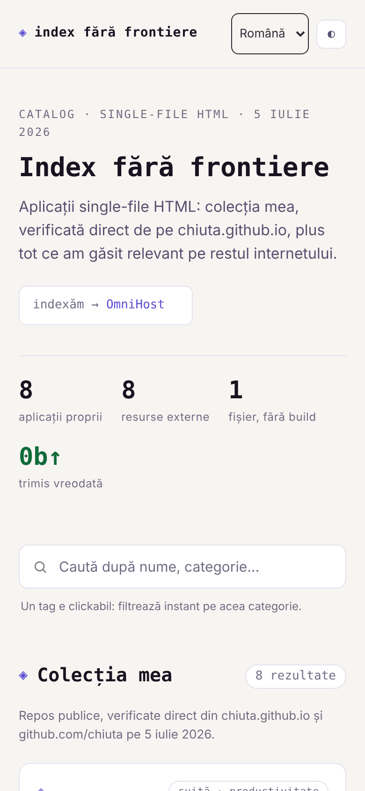
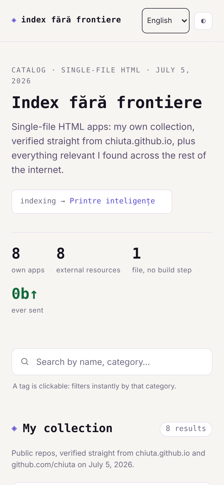
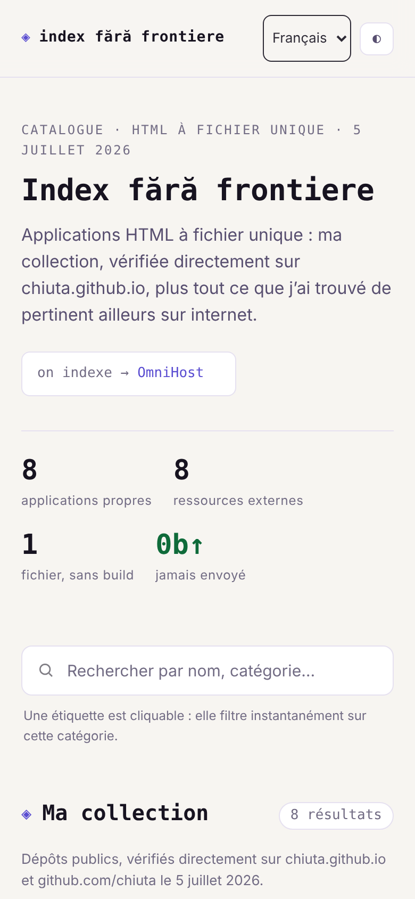
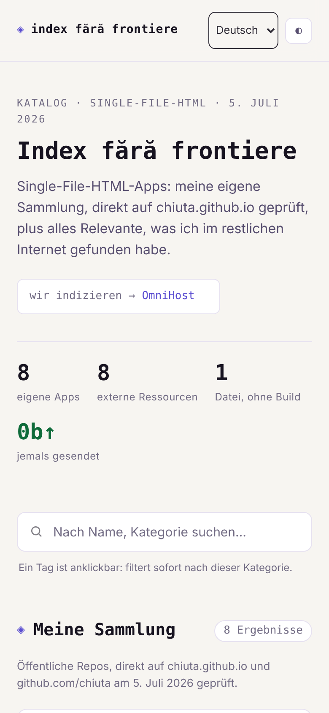
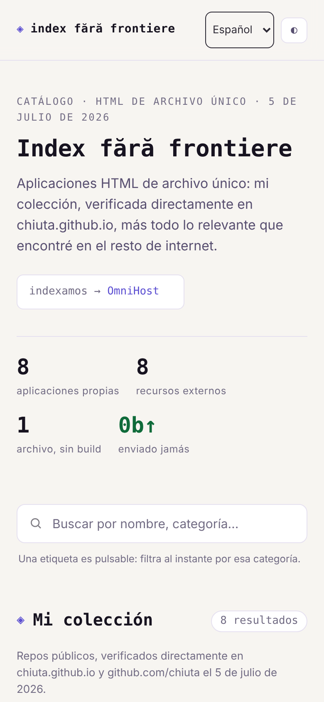
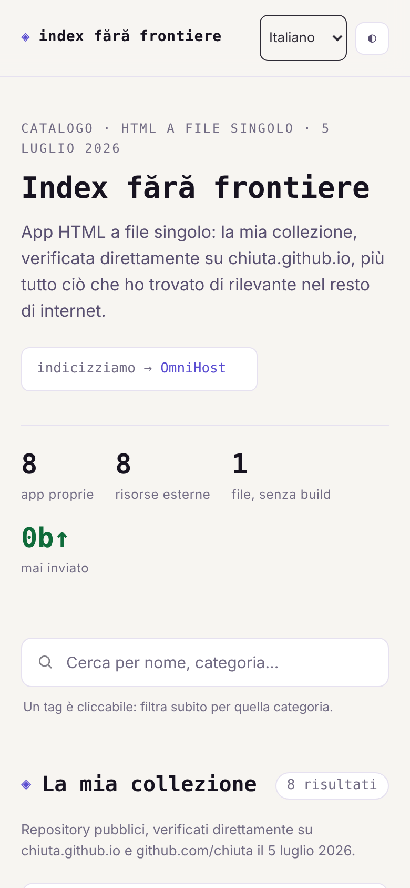
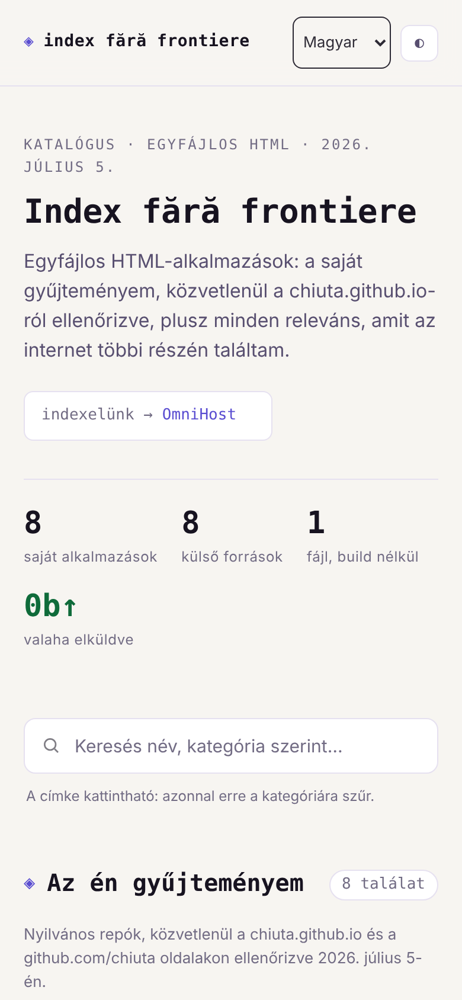
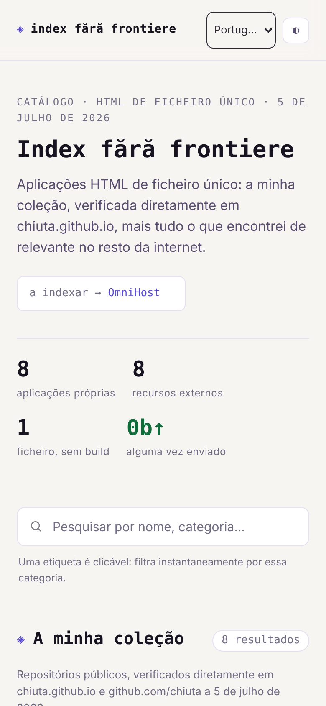

# Index fără frontiere

[English](README.md) · [Română](README.ro.md) · **Français** · [Italiano](README.it.md) · [Español](README.es.md) · [Português](README.pt.md) · [Deutsch](README.de.md) · [Magyar](README.hu.md)

Catalogue d’applications HTML à fichier unique : la collection de chiuta.github.io et des ressources externes pertinentes.

**[Ouvrir l’application →](https://index-fara-frontiere.chiuta.ro/)**

_Version: 1.2.2 · Dernière mise à jour: 2026-11-17_

| 1 | 2 | 3 |
|---|---|---|
|  |  |  |

## Captures d’écran

       

## Fonctions

- Huit projets de la collection de l’auteur et huit ressources externes, clairement signalées.
- Recherche en direct, étiquettes cliquables, sélecteur de langue (8 langues), thème sombre/clair, entrée auto-référencée.
- Entièrement hors ligne : aucune requête réseau, aucune télémétrie (CSP `connect-src none`).

## Utilisation

Ouvrez la page en ligne, ou téléchargez `index.html` et ouvrez-le dans un navigateur récent. Sans installation ni build.

## Limites

- Instantané statique vérifié le 5 juillet 2026 ; non mis à jour automatiquement.
- Les entrées se trouvent dans les tableaux `OWN` et `EXTERNAL` au début du script.
- Interface en 8 langues (RO, EN, FR, DE, ES, IT, HU, PT), au choix dans le sélecteur de l’application ; traductions assistées par machine, non relues par des locuteurs natifs.

## Confidentialité

Aucun suivi, aucune requête réseau (CSP `connect-src none`), aucun compte. Les données restent dans ce navigateur (localStorage) et peuvent être effacées à tout moment.

## Licence

MIT — voir [LICENSE](LICENSE).
