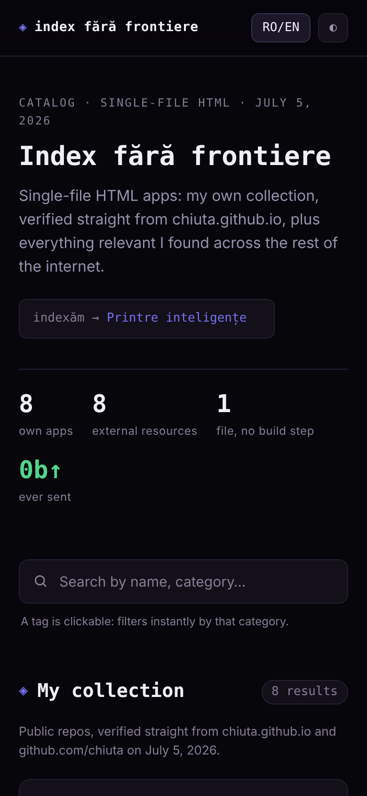
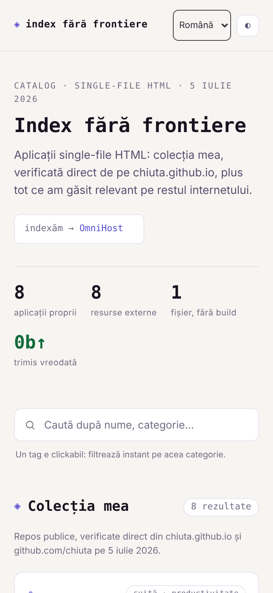
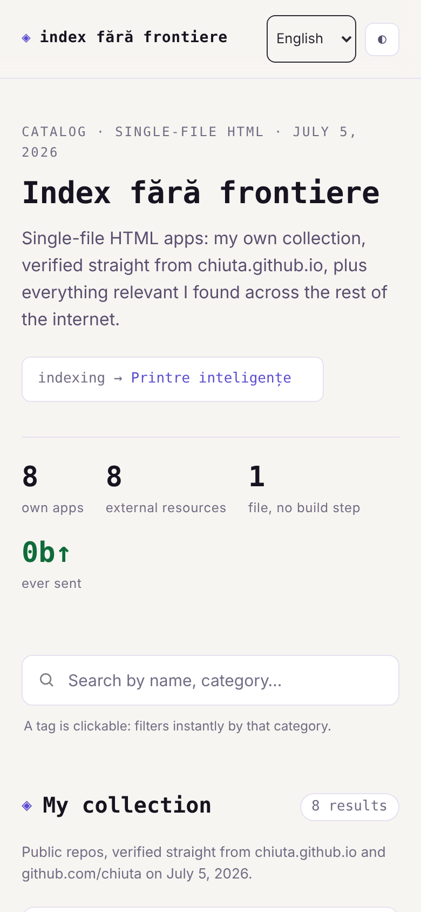
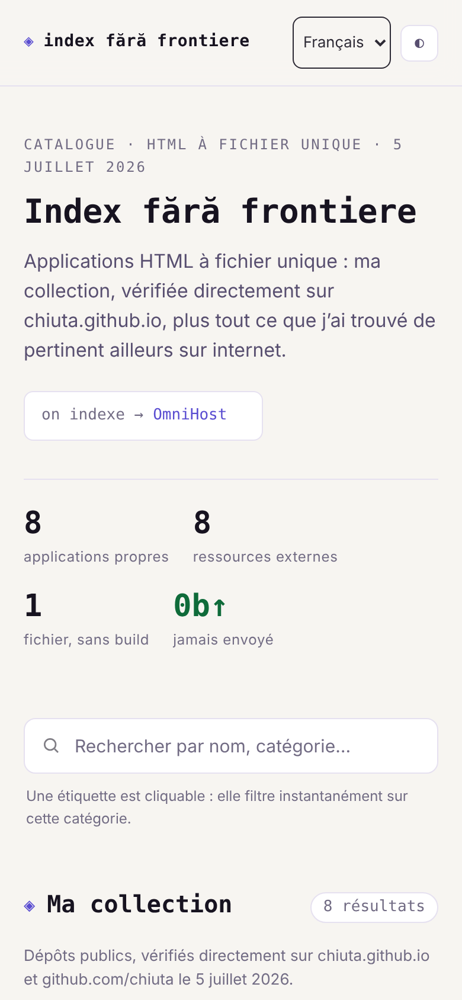
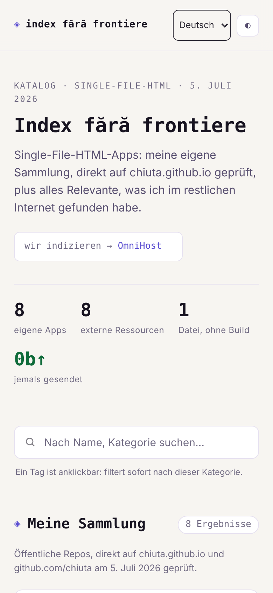
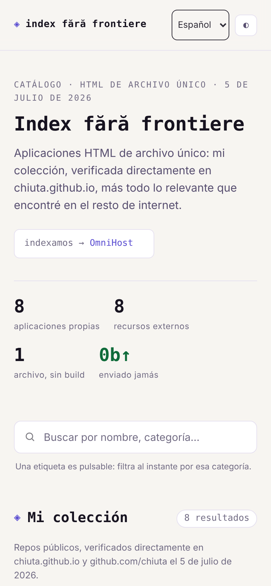
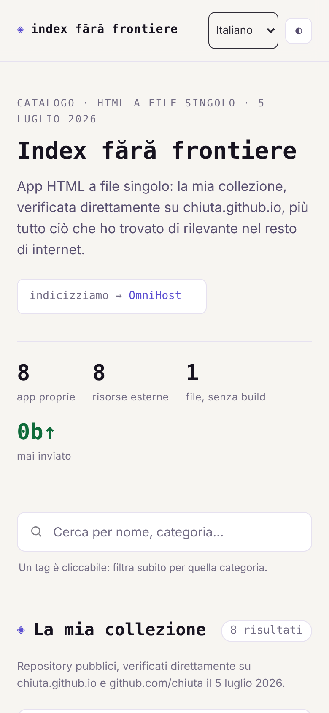
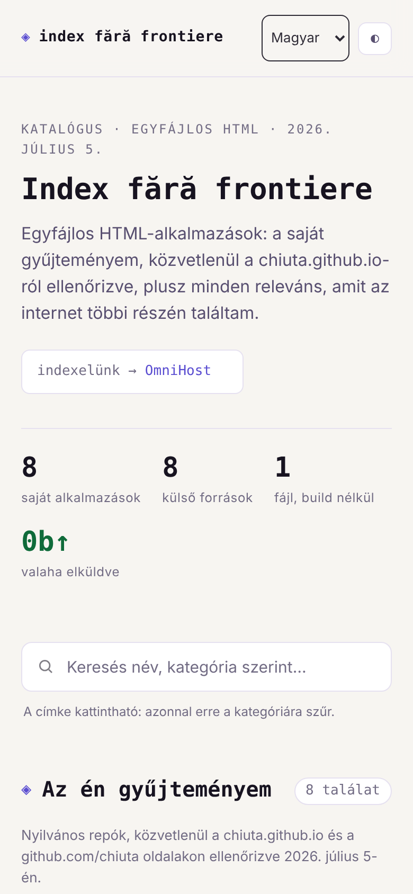
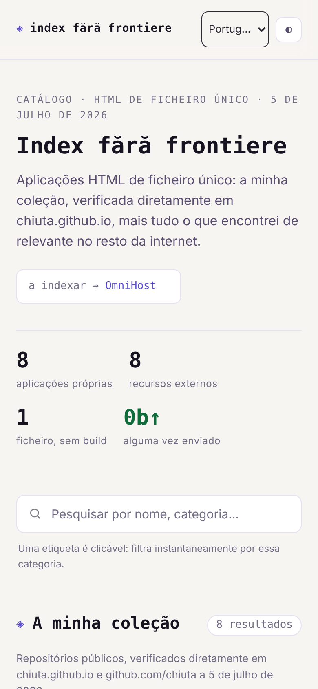

# Index fără frontiere

**English** · [Română](README.ro.md) · [Français](README.fr.md) · [Italiano](README.it.md) · [Español](README.es.md) · [Português](README.pt.md) · [Deutsch](README.de.md) · [Magyar](README.hu.md)

Catalog of single-file HTML apps: the chiuta.github.io collection plus relevant external resources.

**[Open the app →](https://index-fara-frontiere.chiuta.ro/)**

_Version: 1.2.1 · Last updated: 2026-11-15_

| 1 | 2 | 3 |
|---|---|---|
|  |  |  |

## Screenshots

       

## Features

- Eight projects from the author’s collection and eight external resources, clearly marked.
- Live search, clickable tags, language selector (8 languages), dark/light theme, self-referencing entry.
- Fully offline: no network requests, no telemetry (CSP `connect-src none`).

## Usage

Open the page online, or download `index.html` and open it in a recent browser. No installation, no build.

## Limits

- A static snapshot checked on 5 July 2026; it is not updated automatically.
- Entries live in the `OWN` and `EXTERNAL` arrays at the start of the script.
- Interface in 8 languages (RO, EN, FR, DE, ES, IT, HU, PT), chosen from the selector in the app; translations are machine-assisted and not reviewed by native speakers.

## Privacy

No tracking, no network requests (CSP `connect-src none`), no accounts. Data stays in this browser (localStorage) and can be erased at any time.

## License

MIT — see [LICENSE](LICENSE).
