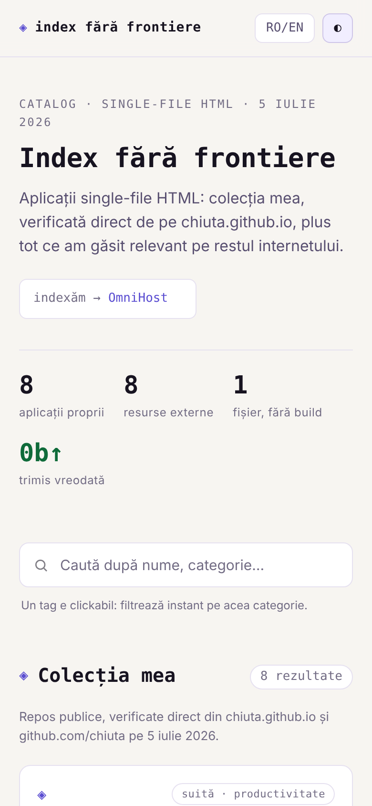

# Index fără frontiere

[English](README.md) · [Română](README.ro.md) · [Français](README.fr.md) · [Italiano](README.it.md) · [Español](README.es.md) · **Português** · [Deutsch](README.de.md) · [Magyar](README.hu.md)

Catálogo de aplicações HTML de ficheiro único: a coleção de chiuta.github.io e recursos externos relevantes.

**[Abrir a aplicação →](https://index-fara-frontiere.chiuta.ro/)**

_Versão: 1.0.0 · Última atualização: 2026-11-14_

| 1 | 2 | 3 |
|---|---|---|
|  |  |  |

## Funcionalidades

- Oito projetos da coleção do autor e oito recursos externos, claramente assinalados.
- Pesquisa em tempo real, etiquetas clicáveis, alternância RO/EN, tema escuro/claro, entrada autorreferencial.
- Totalmente offline: sem pedidos de rede nem telemetria (CSP `connect-src none`).

## Utilização

Abre a página online, ou descarrega `index.html` e abre-o num navegador recente. Sem instalação nem build.

## Limites

- Instantâneo estático verificado a 5 de julho de 2026; não é atualizado automaticamente.
- As entradas estão nos arrays `OWN` e `EXTERNAL` no início do script.
- Interface apenas em romeno e inglês.

## Privacidade

Sem rastreamento, sem pedidos de rede (CSP `connect-src none`), sem contas. Os dados ficam neste navegador (localStorage) e podem ser apagados a qualquer momento.

## Licença

MIT — ver [LICENSE](LICENSE).
