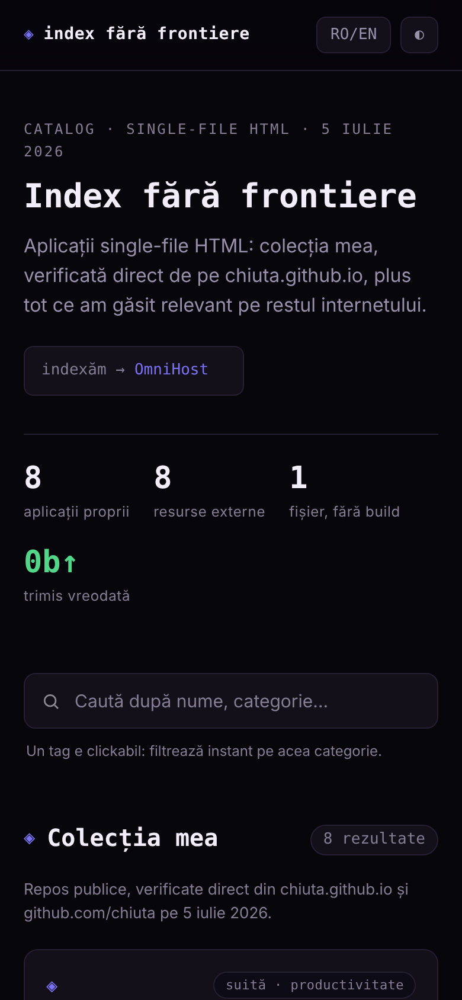
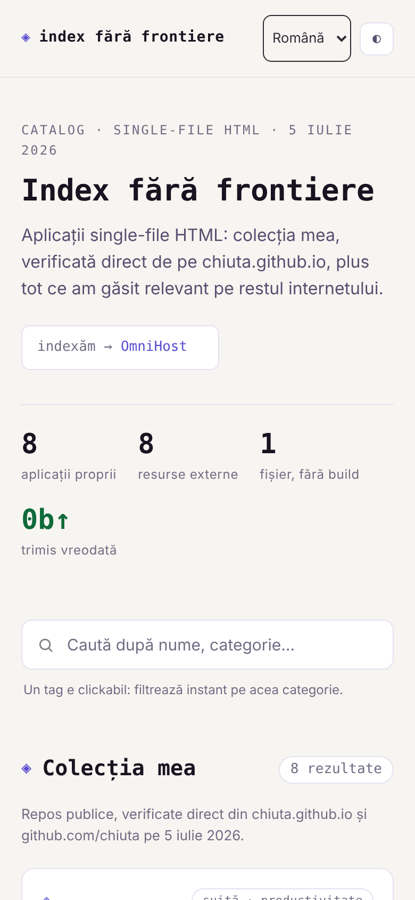
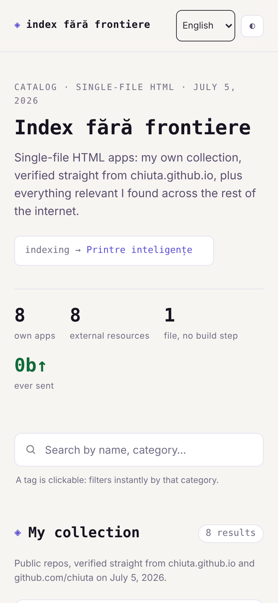
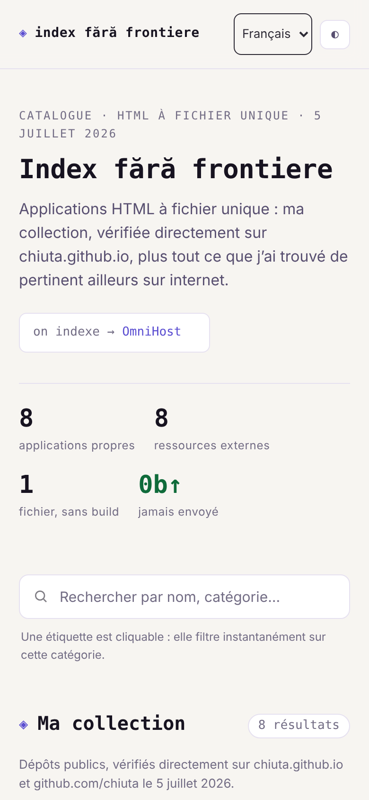
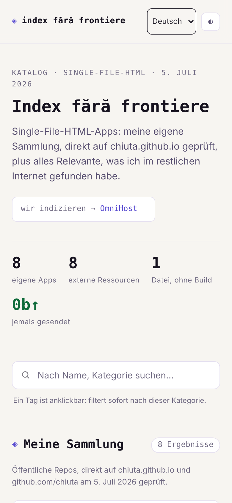
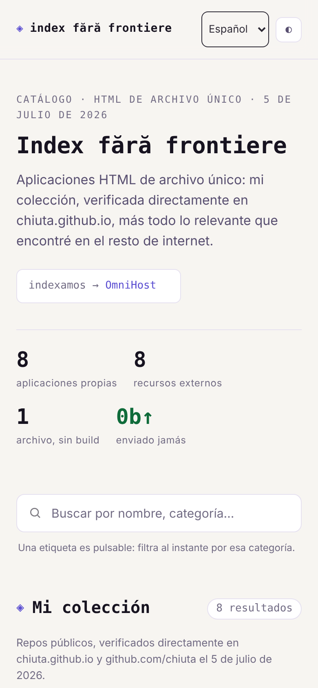
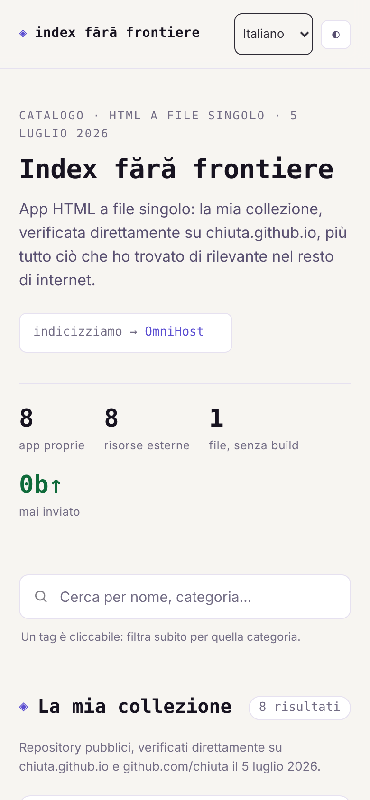
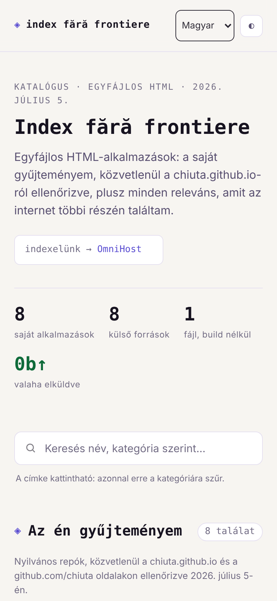
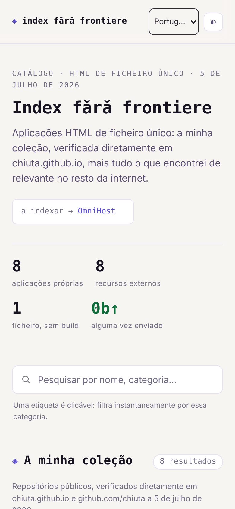

# Index fără frontiere

[English](README.md) · **Română** · [Français](README.fr.md) · [Italiano](README.it.md) · [Español](README.es.md) · [Português](README.pt.md) · [Deutsch](README.de.md) · [Magyar](README.hu.md)

Catalog de aplicații HTML single-file: colecția de pe chiuta.github.io plus resurse externe relevante.

**[Deschide aplicația →](https://index-fara-frontiere.chiuta.ro/)**

_Versiune: 1.2.1 · Ultima actualizare: 2026-11-15_

| 1 | 2 | 3 |
|---|---|---|
|  |  |  |

## Capturi de ecran

       

## Funcții

- Opt proiecte din colecția autorului și opt resurse externe, marcate clar.
- Căutare live, etichete clicabile, selector de limbă (8 limbi), temă întunecată/luminoasă, intrare autoreferențială.
- Complet offline: fără cereri de rețea, fără telemetrie (CSP `connect-src none`).

## Utilizare

Deschide pagina online sau descarcă `index.html` și deschide-l într-un browser recent. Fără instalare, fără build.

## Limite

- Instantaneu static verificat la 5 iulie 2026; nu se actualizează automat.
- Intrările sunt în array-urile `OWN` și `EXTERNAL` de la începutul scriptului.
- Interfață în 8 limbi (RO, EN, FR, DE, ES, IT, HU, PT), aleasă din selectorul din aplicație; traducerile sunt asistate automat și nerevizuite de vorbitori nativi.

## Confidențialitate

Fără urmărire, fără cereri de rețea (CSP `connect-src none`), fără conturi. Datele rămân în acest browser (localStorage) și pot fi șterse oricând.

## Licență

MIT — vezi [LICENSE](LICENSE).
